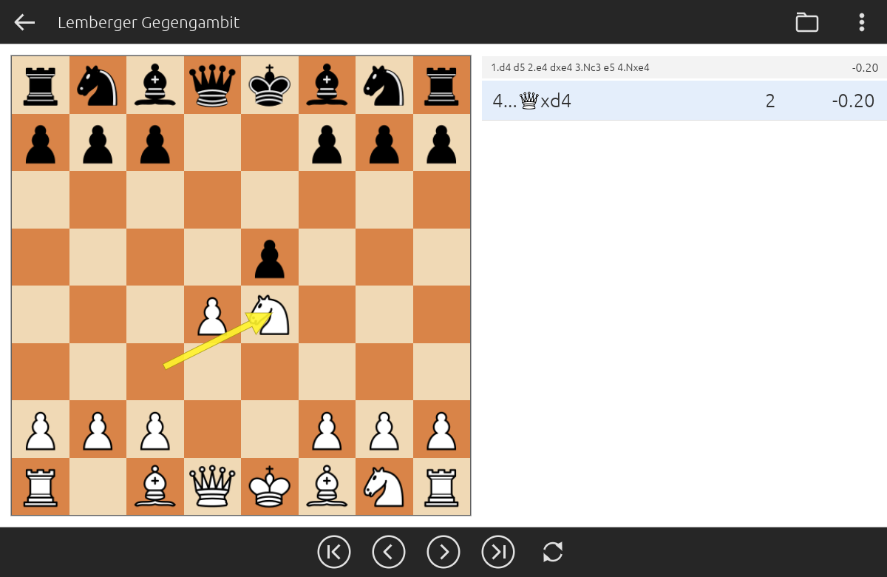

# PGN Tree Viewer

A small desktop program for browsing an **opening tree** stored in a PGN file,
together with the **engine evaluation** of every position.

It is meant for PGNs that were grown with an engine (see
[Creating your own analysed PGN](#creating-your-own-analysed-pgn)): every move
carries the evaluation of the resulting position as a comment, and the
variations form a tree of candidate moves. The viewer shows that tree the way
opening explorers of chess apps do: a board, and next to it the list of moves
you can play from the current position.



Single self-contained executable for **Windows** and **Linux / Ubuntu**, plus an
**Android app** (APK). No runtime and no extra files needed.

## Features

- Board on the left, list of continuations on the right.
- For every continuation:

  | column | meaning |
  |---|---|
  | **Move** | e.g. `4.Qh5` or `4...exd4`, piece letters shown as figurines |
  | **Count** | how many continuations follow this move (next level of the tree only) |
  | **Evaluation** | evaluation of the position after the move, from White's point of view (`+0.35`, `-1.20`, `#3`) |

- Grey info strip with the current line and the evaluation of the current position.
- Yellow arrow for the last move played.
- Hover over a row to see the full move comment.
- Flip the board, copy the FEN of the current position.
- Positive evaluations are shown in green, negative in red (threshold ±0.30).

## Usage

1. Start `PgnTreeViewer.exe` (Windows) or `./PgnTreeViewer-linux` (Linux).
2. Click **Open PGN…** and choose a `.pgn` file.
3. Click a move in the list to play it. To go back, use the two buttons at the bottom
   (**|<** start position, **<** one move back) or the keyboard:

| Key | Action |
|---|---|
| ← | one move back |
| → / Enter | play the selected move |
| ↑ / ↓ | select a move in the list |
| Home / End | start position / end of the selected line |
| F | flip board |

The ⋮ menu offers *Open PGN…*, *Reload* (re-read the file from disk), *Copy FEN*, *Flip board* and
*Info…* (version and build date).
The title shows the PGN's `ChapterName` or `Event` header, or the file name.

### What the viewer reads from the PGN

- The **first game** of the file, including all nested variations.
- Optional `[FEN "…"]` header for a non-standard start position.
- The evaluation from each move comment, written as either:
  - a plain value: `{ +0.35 }`, `{ -1.20 }`, `{ #-3 }`, or
  - a lichess-style tag: `{ [%eval 0.35] }`.
- Moves without an evaluation show `–`.
- Move numbers and NAGs (`$1`, `!`, `?`) are skipped; `;` comments are supported.

## Download / Build

Prebuilt binaries are in [`dist/`](dist) (desktop) and [`android/`](android) (APK):

- `dist/PgnTreeViewer.exe` for Windows 10/11 (only uses standard Windows DLLs)
- `dist/PgnTreeViewer-linux` for Linux / Ubuntu (x86-64, X11 or Wayland)
- `android/PgnTreeViewer.apk` for Android 8.0 or newer (64-bit ARM, i.e. practically every phone since 2017)

To build yourself, install [Rust](https://rustup.rs) and run:

```bash
# one-time setup for cross-compiling the Windows exe on Linux
rustup target add x86_64-pc-windows-gnu x86_64-unknown-linux-gnu
sudo apt install gcc-mingw-w64-x86-64 g++-mingw-w64-x86-64

./build.sh            # both binaries into dist/
./build.sh linux      # only Linux
./build.sh windows    # only Windows
./clean.sh            # remove build output

cargo test --release --target x86_64-unknown-linux-gnu   # PGN parser tests
```

On a Windows machine with Rust installed, `cargo build --release` works as well.

Under WSL2 (WSLg), if the program does not start because of Wayland, run it via X11:
`env -u WAYLAND_DISPLAY ./PgnTreeViewer-linux`.

## Android

**Install:** copy `android/PgnTreeViewer.apk` to the phone (USB, cloud, mail) and tap it.
Android asks once to allow installing apps from that source (the file manager or browser).
The app is not in the Play Store and is signed with its own key, so Play Protect may show a warning.

**Open a PGN** in one of three ways:
- tap the folder icon in the app and pick the file in Android's file picker,
- tap a `.pgn` file in a file manager / download list and choose *PGN Tree Viewer* under "Open with",
- *Share* a PGN file (e.g. from a mail or chat app) to *PGN Tree Viewer*.

Tap a move to play it. The two buttons at the bottom go back to the start or one move back, and so does
Android's back button or gesture (at the start position it leaves the app). Flip the board via the ⋮ menu.
In portrait mode the board is on top and the move list below it. In landscape mode they are side by side,
as on the PC.

**Build the APK** (Linux / WSL, no Android Studio or Gradle needed):

```bash
# one-time setup
#   JDK 17                 -> ~/android/jdk17     (e.g. Eclipse Temurin)
#   Android command-line tools -> ~/android/sdk/cmdline-tools/latest
~/android/sdk/cmdline-tools/latest/bin/sdkmanager --sdk_root=$HOME/android/sdk \
    "platforms;android-34" "build-tools;34.0.0" "ndk;29.0.14206865"
rustup target add aarch64-linux-android
cargo install cargo-ndk

./build-android.sh        # -> android/PgnTreeViewer.apk
```

The script builds the Rust code as a native library (`cargo ndk`), compiles the small Java activity
in `android/java/` (Android's file picker and "Open with"), links manifest and icon with `aapt2`,
then aligns and signs the APK. On the first run it creates a signing key at
`~/android/keys/pgntreeviewer.jks`. **Keep that file:** an installed app can only be updated by an APK
signed with the same key. Paths and password can be changed via environment variables (see the script header).

---

## Creating your own analysed PGN

The PGNs this viewer is made for are produced in two steps:

1. **You** write a small *seed* PGN with the opening and the lines you want to
   study, e.g. the main line plus a few sidelines from your opening book.
2. **Stockfish** evaluates every position of the seed and then grows the tree
   from its end points, following fixed rules.

### The rules used to grow the tree

At every position Stockfish runs in *MultiPV* mode, which returns its best 5
moves with an evaluation for each. From those:

| Rule | Default | Meaning |
|---|---|---|
| Time per position | 30 s | fixed thinking time for every position |
| Candidate moves | 5 (MultiPV) | how many engine moves are considered |
| Branching side | White | for this side, *all good moves* are kept |
| "Significantly worse" | 50 cp (0.50 pawns) | candidates are added best-first until the first one that is more than 0.50 pawns worse than the best move; that one and all weaker moves are dropped |
| Other side | best reply only | the opponent always answers with Stockfish's best move |
| Cut-off | ±100 cp (±1.00) | a branch stops once the position is clearly decided |
| Depth | move 12 | the last move added is the other side's 12th move |

Every move gets one comment: the evaluation of the resulting position from White's point of view,
e.g. `{ +0.35 }`. The moves of the seed PGN are kept unchanged; only their end points are expanded.

**Example.** After `1.d4 d5 2.e4 dxe4 3.Nc3 e5 4.Nxe4 Qxd4` White has `5.Bd3` (−0.16) and
`5.Qxd4` (−0.51) within 0.50 of the best, so both are kept. Black then answers each with its
single best move, and so on.

Why "branch for one side only"? If both sides branch, the tree grows
exponentially and never finishes. Branching for the side *you* play gives you
all your good options and the opponent's most testing reply to each.

### Time needed

At 30 s per position Stockfish analyses about 120 positions per hour (≈ 2,900 per day).
A typical tree down to move 12 needs several thousand positions, so plan on **hours to days**.
You can reduce this with a shorter time (`--time 10`), a lower depth (`--last-move 10`), a stricter threshold
(`--worse-cp 30`) or a tighter cut-off (`--cutoff-cp 80`). The output file is updated after every
move, so you can open it in the viewer at any time to look at the partial tree.

### Option A: run the script yourself

Requirements:

- Python 3 and [python-chess](https://pypi.org/project/chess/): `pip install chess`
- A Stockfish binary from <https://stockfishchess.org/download/>

Create a seed PGN, e.g. `seed.pgn`:

```
[Event "Lemberger Countergambit"]

1. d4 d5 2. e4 dxe4 3. Nc3 e5 4. Nxe4 (4. dxe5) (4. Qh5) *
```

Run:

```bash
python3 tools/build_tree.py seed.pgn tree.pgn --engine /path/to/stockfish
```

All options (`python3 tools/build_tree.py --help`):

| Option | Default | |
|---|---|---|
| `--engine` | `stockfish` | path to the UCI engine |
| `--time` | `30` | seconds per position |
| `--multipv` | `5` | candidate moves per position |
| `--branch` | `white` | `white`, `black` or `both` |
| `--worse-cp` | `50` | "significantly worse" threshold in centipawns |
| `--cutoff-cp` | `100` | stop branches beyond ±this evaluation |
| `--last-move` | `12` | last full move number to add |
| `--threads`, `--hash` | CPU cores − 2, 1024 MB | engine settings |
| `--cache` | `tree.pgn.cache.json` | engine results by position |

Engine results are cached, so if you stop the script (Ctrl+C) and start it
again with the same arguments, it continues without re-analysing anything.
The seed file is never modified. You can also change the rules and re-run: positions already in the cache are not analysed again.

### Option B: let Claude do it

With [Claude Code](https://claude.com/claude-code) (or another agent that can run commands on your
machine) you can describe the job in plain language and let Claude set everything up. Claude can
download Stockfish, write or adapt the script, start it in the background and change the rules
later on request. Put your seed PGN into an empty folder, start Claude Code in that folder and paste
a prompt like this:

> The local `seed.pgn` contains the lines of my opening. Please extend it with Stockfish analysis
> and write the result to `tree.pgn`.
>
> - Use the latest Stockfish for my OS. Run it in MultiPV 5 mode for **30 seconds per position**.
> - Branch only for **White**: keep Stockfish's best move plus all further candidates until the first
>   one that is more than **0.50 pawns** worse than the best. Black plays only its best reply.
> - If the evaluation of a position is above **+1.00** or below **−1.00**, stop that branch.
> - Go down to **move 12**.
> - Keep my moves from the seed unchanged and only expand from their end points.
> - Add the evaluation of every position as a move comment, a single value from White's point of
>   view, like `{ +0.35 }`.
> - Write `tree.pgn` to disk after every new move, so I can watch the progress.
> - Cache the engine results so that an interrupted run can be resumed.
> - Write the rules into a `CLAUDE.md` so we can continue later.

Claude can also run `tools/build_tree.py` from this repository instead of writing a new script.
Then open `tree.pgn` in the PGN Tree Viewer.

Tips:

- Ask Claude for an estimate of the run time before it starts, and for the tree's progress while it runs.
- To change a rule mid-run ("cut off at ±0.80 instead", "also branch for Black from move 8"), just tell
  Claude. Thanks to the cache, a restart does not lose any finished analysis.
- The seed PGN can come from anywhere, e.g. a lichess study export. Its comments are replaced by the evaluations in the output.

---

## Project layout

```
src/app.rs            UI: board, arrow, move list, navigation
src/main.rs           desktop entry point
src/lib.rs            library + Android entry point
src/android.rs        JNI bridge to the Java activity (Android only)
src/pgn.rs            PGN → move tree parser (+ unit tests)
android/              manifest, launcher icon and MainActivity.java for the APK
assets/pieces/        piece images (embedded into the binary)
tools/build_tree.py   grows an analysed opening tree with Stockfish
tools/make_pieces.py  creates the transparent piece images
docs/screenshot.png   screenshot for this README
build.sh / clean.sh   desktop build helpers
build-android.sh      Android APK build
dist/                 prebuilt binaries
```

Built with [egui/eframe](https://github.com/emilk/egui) and
[shakmaty](https://github.com/niklasf/shakmaty) (chess rules).
